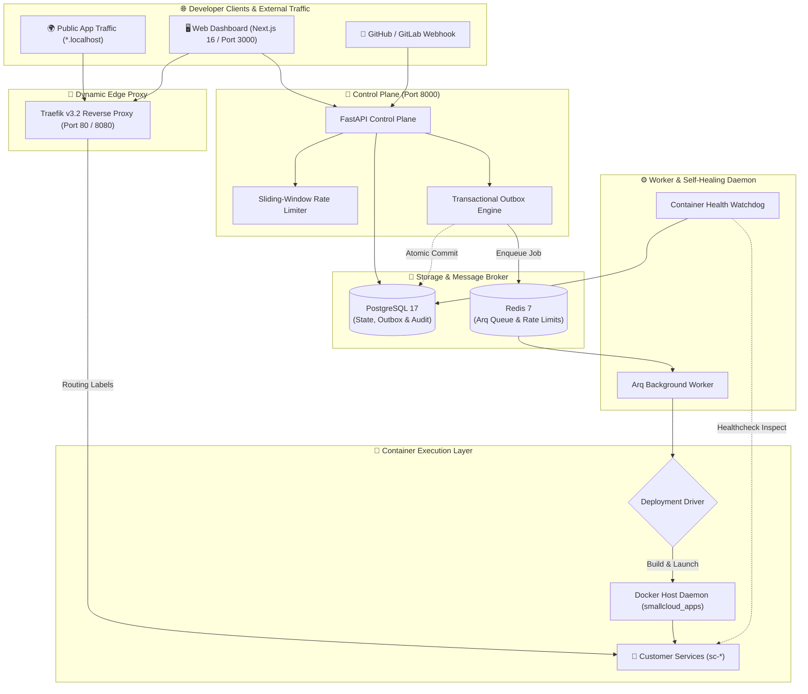

<div align="center">

# ☁️ SMALL SOFTWARE CLOUD
### *The Developer-First, Self-Hosted Container Cloud & Micro-PaaS*

<p align="center">
  <a href="https://github.com">
    
  </a>
</p>

<p align="center">
  
  
  
  
  
  
</p>

<p align="center">
  
  
  
  
  
</p>

<p align="center">
  <b>A lightweight, ultra-reliable alternative to Heroku, Render, and Railway for your own VPS.</b>
  <br />
  Turn any server into an autonomous developer platform with isolated workspaces, dynamic routing, live logs, and zero-headache deployments.
</p>

---

[Explore Features](#-key-capabilities) • [Architecture](#-system-architecture) • [Quick Start](#-quick-start) • [API Specs](#-rest-api-overview) • [Backup & Restore](#-disaster-recovery--backup-cli) • [Documentation](#-documentation)

---

</div>

<br/>

## 🌟 Key Capabilities

<table>
  <tr>
    <td width="50%">
      <h3 align="center">⚡ Autonomous Container Runtime</h3>
      <ul>
        <li><b>Dynamic Dockerfile Synthesis:</b> Automatically generates optimized multi-stage build environments for <b>Node.js</b> and <b>Python</b> without requiring user Dockerfiles.</li>
        <li><b>Traefik v3.2 Dynamic Ingress:</b> Auto-maps applications to clean local subdomains: <code>http://&lt;service-slug&gt;.localhost</code>.</li>
        <li><b>Hardened Resource Isolation:</b> Enforces kernel-level cgroups memory caps (<code>--memory</code>) and CPU throttling (<code>--cpus</code>) per container.</li>
      </ul>
    </td>
    <td width="50%">
      <h3 align="center">🛡️ Resilient Outbox & Queuing</h3>
      <ul>
        <li><b>Transactional Outbox Pattern:</b> Deployment requests and DB changes commit atomically to Postgres. Zero dropped jobs even during Redis or network failovers!</li>
        <li><b>Arq Async Worker:</b> High-throughput asynchronous background job processor with non-blocking concurrency.</li>
        <li><b>Self-Healing Watchdog:</b> Automated cron reconciling stale builds and detecting crashed or OOM-killed containers.</li>
      </ul>
    </td>
  </tr>
  <tr>
    <td width="50%">
      <h3 align="center">📡 Real-Time Observability</h3>
      <ul>
        <li><b>SSE Live Build Streams:</b> Server-Sent Events (SSE) stream terminal compilation logs to the browser in real-time.</li>
        <li><b>Runtime Container Logs:</b> On-demand inspection of container stdout/stderr output (<code>docker logs --tail</code>).</li>
        <li><b>Interactive Cancel & Restart:</b> Instantly terminate running deployments with full signal cleanup.</li>
      </ul>
    </td>
    <td width="50%">
      <h3 align="center">🔐 Enterprise Configuration & Auth</h3>
      <ul>
        <li><b>Multi-Tenant Workspaces:</b> Isolated team workspaces with granular Role-Based Access Control (Owner, Admin, Developer, Viewer).</li>
        <li><b>Smart .env Bulk Parser:</b> Paste complete <code>.env</code> configurations with automated sensitive keyword detection (<code>KEY</code>, <code>SECRET</code>, <code>TOKEN</code>).</li>
        <li><b>CI/CD Deploy Webhooks:</b> Trigger zero-touch deployments directly from GitHub Actions or GitLab CI via secret bearer tokens.</li>
      </ul>
    </td>
  </tr>
</table>

<br/>

---

## 🏗️ System Architecture



<br/>

---

## 🚀 Quick Start

### 1. Prerequisites
- **Docker Engine** & **Docker Compose v2+** (or Docker Desktop on Windows/macOS)
- **Git**
- *Recommended:* 4 GB+ RAM

### 2. Launch with One Command
Clone the repository and spin up the complete cloud platform:

```bash
# Clone repository
git clone https://github.com/your-org/small-software-cloud.git
cd small-software-cloud

# Copy environment configuration
cp .env.example .env

# Generate a secure JWT secret key
python scripts/generate_secret.py

# Launch entire platform via Docker Compose
docker compose up -d --build
```

### 3. Open in Browser

| Service | Address | Description |
| :--- | :--- | :--- |
| **🎨 Web Dashboard** | [http://localhost:3000](http://localhost:3000) | Editorial Next.js UI with real-time logs & workspace switcher |
| **⚡ Control Plane API** | [http://localhost:8000](http://localhost:8000) | FastAPI RESTful control plane |
| **📚 Interactive Swagger Docs** | [http://localhost:8000/docs](http://localhost:8000/docs) | Interactive API exploration & testing |
| **🚦 Traefik Dashboard** | [http://localhost:8080](http://localhost:8080) | Live ingress routers, middlewares, and services |

<br/>

---

## 💻 Local Development (Without Docker)

You can run individual microservices natively on your machine:

<details>
<summary><b>▶️ Running the FastAPI Control Plane</b></summary>

```bash
cd apps/api

# Create & activate Python virtual environment
python -m venv .venv
source .venv/bin/activate  # Windows: .venv\Scripts\Activate.ps1

# Install dependencies
pip install -e '.[dev]'

# Run database migrations
alembic upgrade head

# Launch API server with hot reload
python -m uvicorn app.main:app --host 127.0.0.1 --port 8000 --reload
```
</details>

<details>
<summary><b>▶️ Running the Next.js 16 Web Dashboard</b></summary>

```bash
cd apps/web

# Install npm packages
npm install

# Start Next.js development server with Turbopack
npm run dev
```
Open [http://localhost:3000](http://localhost:3000) to view your dashboard.
</details>

<details>
<summary><b>▶️ Running the Background Worker</b></summary>

```bash
cd apps/api

# Launch Arq Worker with Cron & Health Watchdog
python -m arq app.worker.WorkerSettings
```
</details>

<br/>

---

## 🧪 Test Suite & Code Verification

Small Software Cloud features an extensive, automated test suite covering authentication, transactional outbox relays, rate limiting, and end-to-end platform lifecycles.

```bash
# Run all tests with pytest
python -m pytest apps/api/tests -v

# Run code style & linting checks
python -m ruff check apps/api
```

```text
============================= test session starts =============================
collected 31 items

apps/api/tests/test_api.py::test_root_endpoint PASSED                    [  3%]
apps/api/tests/test_api.py::test_health_live_endpoint PASSED             [  6%]
apps/api/tests/test_api.py::test_unauthorized_access PASSED              [  9%]
apps/api/tests/test_api.py::test_dashboard_unauthorized PASSED           [ 12%]
apps/api/tests/test_api.py::test_organizations_unauthorized PASSED       [ 16%]
apps/api/tests/test_config.py::test_default_driver_is_mock PASSED        [ 19%]
apps/api/tests/test_config.py::test_cors_list_parses_csv PASSED          [ 22%]
apps/api/tests/test_config.py::test_production_requires_signups_disabled PASSED [ 25%]
apps/api/tests/test_config.py::test_docker_driver_setting_accepted PASSED [ 29%]
apps/api/tests/test_config.py::test_invalid_driver_rejected PASSED       [ 32%]
apps/api/tests/test_config.py::test_driver_factory PASSED                [ 35%]
apps/api/tests/test_env_and_hooks.py::test_raw_env_import_and_secrets PASSED [ 38%]
apps/api/tests/test_env_and_hooks.py::test_deploy_hook_execution PASSED  [ 41%]
apps/api/tests/test_full_workflow.py::test_complete_platform_lifecycle_workflow PASSED [ 45%]
apps/api/tests/test_outbox.py::test_record_outbox_event PASSED           [ 48%]
apps/api/tests/test_outbox.py::test_relay_outbox_events_success PASSED   [ 51%]
apps/api/tests/test_outbox.py::test_relay_outbox_events_failure_retry PASSED [ 54%]
apps/api/tests/test_rate_limit.py::test_sliding_window_rate_limiter_in_memory PASSED [ 58%]
apps/api/tests/test_rate_limit.py::test_rate_limiter_isolated_identifiers PASSED [ 61%]
apps/api/tests/test_schemas.py::test_slug_rejects_spaces PASSED          [ 64%]
apps/api/tests/test_schemas.py::test_repository_requires_https_and_allowed_host PASSED [ 67%]
apps/api/tests/test_schemas.py::test_supported_github_repository_accepted PASSED [ 70%]
apps/api/tests/test_schemas.py::test_invalid_image_digest_rejected PASSED [ 74%]
apps/api/tests/test_project_create_with_org_id PASSED                    [ 77%]
apps/api/tests/test_project_update_validation PASSED                     [ 80%]
apps/api/tests/test_service_update_validation PASSED                     [ 83%]
apps/api/tests/test_env_var_bulk_update PASSED                           [ 87%]
apps/api/tests/test_organization_create_validation PASSED                [ 90%]
apps/api/tests/test_security.py::test_password_hash_round_trip PASSED    [ 93%]
apps/api/tests/test_security.py::test_access_token_round_trip PASSED     [ 96%]
apps/api/tests/test_security.py::test_invalid_token_rejected PASSED      [100%]

============================= 31 passed in 2.99s ==============================
```

<br/>

---

## 📡 REST API Overview

| Method | Endpoint | Description | Auth Required |
| :--- | :--- | :--- | :---: |
| `POST` | `/v1/auth/register` | Register new user + workspace (rate limited 3/min) | ❌ |
| `POST` | `/v1/auth/login` | Authenticate & retrieve JWT token (rate limited 5/min) | ❌ |
| `GET` | `/v1/dashboard/overview` | Composite single-query dashboard overview | ✅ |
| `GET / POST`| `/v1/organizations` | Workspace listing and creation | ✅ |
| `GET / POST`| `/v1/projects` | Project management within workspace | ✅ |
| `GET / POST`| `/v1/projects/{id}/services`| Service creation with runtime & port config | ✅ |
| `GET / PUT` | `/v1/services/{id}/env` | Environment variables management with masking | ✅ |
| `POST` | `/v1/services/{id}/env/raw` | Bulk <code>.env</code> parser with auto-secret detection | ✅ |
| `POST` | `/v1/services/{id}/deploy-token` | Regenerate dedicated continuous deployment token | ✅ |
| `POST` | `/v1/services/{id}/deploy-hook` | **Webhook:** Trigger zero-auth automated deployment | Token |
| `GET` | `/v1/services/{id}/runtime-logs`| Container runtime output (<code>docker logs --tail</code>) | ✅ |
| `GET` | `/v1/deployments/{id}/logs/stream`| **SSE:** Live streaming deployment build output | ✅ / Token |
| `POST` | `/v1/deployments/{id}/cancel` | Terminate and cancel an active deployment job | ✅ |

<br/>

---

## 💾 Disaster Recovery & Backup CLI

Ensure complete data safety with the built-in backup and restore utilities:

### 📦 Create Database Backup
```bash
python scripts/backup.py --keep 7
```
- Dumps PostgreSQL data to compressed `.sql.gz`
- Computes **SHA256 checksum** stored in accompanying `.json` manifest
- Automatically prunes older backups according to retention policy

### 🔄 Restore Database from Backup
```bash
python scripts/restore.py backups/smallcloud_backup_20261014_220000.sql.gz
```
- Validates SHA256 integrity before touching the database
- Restores all schemas, tables, and audit history via `psql`

<br/>

---

## 📁 Repository Layout

```text
small-software-cloud/
├── apps/
│   ├── api/                     # FastAPI Control Plane
│   │   ├── app/
│   │   │   ├── core/            # Config, security, sliding-window rate limiting
│   │   │   ├── db/              # SQLAlchemy session & base models
│   │   │   ├── routes/          # REST endpoints (auth, dashboard, services, env, etc.)
│   │   │   ├── services/        # Deployment drivers (Docker/Mock), Outbox, Audit
│   │   │   ├── models.py        # Relational models (PostgreSQL)
│   │   │   ├── schemas.py       # Pydantic v2 validation contracts
│   │   │   └── worker.py        # Arq worker settings, cron, and health watchdog
│   │   ├── migrations/          # Alembic incremental migration versions (0001 - 0004)
│   │   └── tests/               # 31 Pytest unit and integration tests
│   └── web/                     # Next.js 16 Web Dashboard (React 19 / Turbopack)
│       └── src/app/             # Clean editorial UI with live log streams & modals
├── infra/
│   └── traefik/                 # Traefik v3.2 static configuration
├── scripts/
│   ├── backup.py                # Database backup utility with SHA256 manifest
│   ├── restore.py               # Database restore utility with checksum verification
│   └── generate_secret.py       # Secure token generation
├── docs/                        # Architecture, API guides, and security runbooks
└── compose.yaml                 # Multi-container production-grade composition
```

<br/>

---

## 🔒 Security & Best Practices

- **Zero Untrusted Host Root Access:** Docker builds execute isolated without sharing host root volumes.
- **Strict Network Isolation:** Customer workloads run on an isolated Docker bridge network (`smallcloud_apps`).
- **Secret Masking:** Sensitive environment keys (e.g., `PASSWORD`, `SECRET`, `KEY`, `TOKEN`) are masked (`••••••••`) across logs and API outputs.
- **Brute Force Defense:** Authentication routes are guarded by in-memory / Redis-backed sliding-window rate limiters.

<br/>

---

## 📄 License

Distributed under the **MIT License**. See [LICENSE](LICENSE) for more details.

<div align="center">
  <sub>Engineered with passion for builders and self-hosters worldwide.</sub>
  <br/>
  <b><a href="#-small-software-cloud">Back to Top ↑</a></b>
</div>
